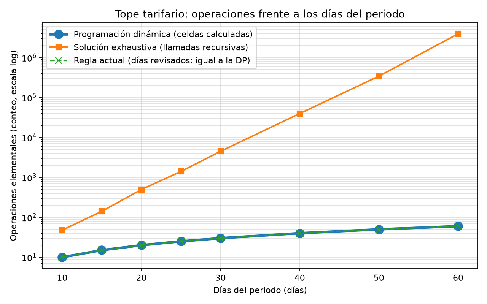
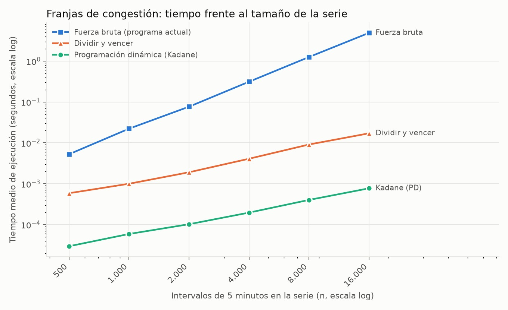
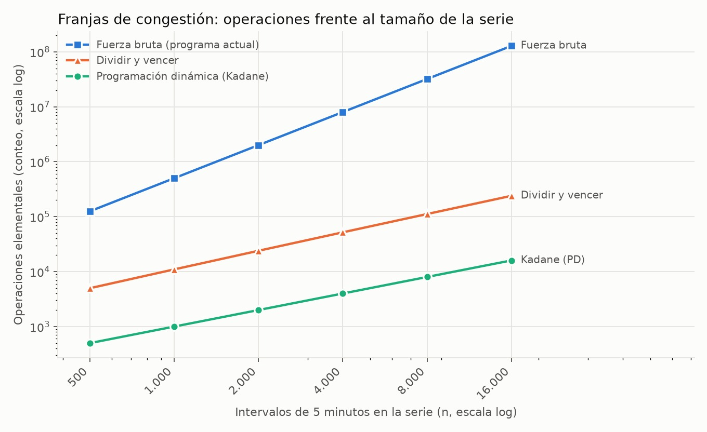
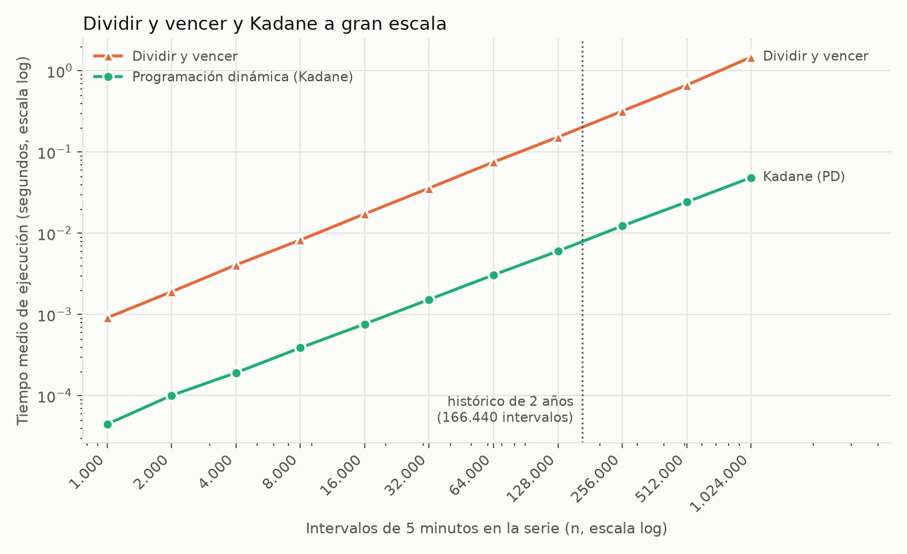

# Rediseño del proceso nocturno de recaudo del SITVM

**Integrantes:**
- Isabella Bermudez Arboleda
- Sofia Villa Muñoz
- Carolina Uribe Builes
- Erian Jose Serna

**Caso asignado:** Caso 1 – Recaudo del transporte (Sistema Integrado de Transporte del Valle Metropolitano, SITVM)

**Operaciones desarrolladas:**
- **Operación 4, liquidación del tope tarifario** (programación dinámica). Es la entrega parcial del Laboratorio 4 (18 de noviembre) y la base de este informe.
- **Operación 3, detección de las franjas de congestión** (dividir y vencer y programación dinámica).

Las operaciones 1 (deduplicación) y 2 (ordenamiento) no se abordan; se retoman como mejora futura en la sección 7.

---

## 1. Análisis del problema

### 1.1 Descripción del problema computacional

Cada noche, con el sistema cerrado, un proceso por lotes concilia las validaciones del día: las depura, liquida lo cobrado a cada tarjeta y entrega la información a Recaudo, Atención al Usuario y Planeación de la Operación. El proceso actual tarda más de 8 horas y la ventana operativa es de 4 (00:00 a 04:00), con lo que los validadores abren con la lista de bloqueos del día anterior, las devoluciones del tope tarifario llegan con semanas de retraso y Planeación decide con una muestra de estaciones. La Gerencia de Tecnología considera que el problema no está en la infraestructura, sino en las estrategias algorítmicas de las cuatro operaciones críticas.

### 1.2 Operaciones críticas y línea base energética

| Operación | Estrategia actual | Crecimiento | Dónde corre | ¿Se aborda? |
|---|---|---|---|---|
| 1. Deduplicación | Compara cada validación con todas las ya aceptadas | Θ(n²), con n ≈ 1.400.000 validaciones por día | Cada noche (ventana de 4 h) | No |
| 2. Ordenamiento | Inserción | Θ(n²) | Cada noche (ventana de 4 h) | No |
| 3. Franjas de congestión | Evalúa todos los tramos de la serie | Θ(n²) como mínimo; n ≈ 166.000 intervalos por estación en el histórico de 2 años, 80 estaciones | Consulta de Planeación (el caso no la sujeta a la ventana) | **Sí** |
| 4. Tope tarifario | Explora todas las combinaciones de pases; no termina con muchos días de viaje, y entonces se aplica una regla simplificada | Exponencial | Cierre de mes (ventana de 4 h) | **Sí** |

Por orden de crecimiento y volumen, las operaciones 1 y 2 son las que más operaciones elementales acumulan (del orden de 5·10¹¹ a 10¹² comparaciones con n = 1.400.000; es un cálculo por complejidad, no una medición). Las operaciones 3 y 4 son inviables en los tamaños que el cliente necesita. Este informe **no mide** las operaciones 1 y 2, así que la línea base del proceso completo es el dato del cliente. Se eligieron la 3 y la 4 porque admiten dividir y vencer y programación dinámica y porque su exactitud se puede verificar contra una referencia independiente.

**Costo energético de la línea base** (energía = potencia × tiempo; 500 W = 0,5 kW):

| Referencia | Cálculo | Resultado |
|---|---|---|
| Proceso completo actual (dato del cliente) | más de 8 h × 0,5 kW | **más de 4 kWh por noche** (cota inferior) |
| Proceso completo, un año | más de 4 kWh × 365 | **más de 1.460 kWh al año** |
| Operación 3, histórico de 2 años de las 80 estaciones, con fuerza bruta Θ(n²) | ≈ 11,7 h × 0,5 kW | ≈ 5,86 kWh por ejecución (estimado, sección 4.5) |
| Operación 4, regla simplificada, 950.000 tarjetas | ≈ 12 s × 0,5 kW | ≈ 0,0017 kWh por cierre (medido en un equipo) |

El programa actual de la operación 4 no termina con tarjetas de muchos días de viaje, así que no tiene un costo energético medible; por eso se compara con la regla simplificada.

### 1.3 Operación 4: liquidación del tope tarifario

Ningún usuario con tarjeta personalizada debe pagar en el mes más que la combinación más barata de pasajes y pases que cubra todos sus viajes; la diferencia se devuelve como saldo.

- **Entradas:** lista de enteros con los viajes de la tarjeta en cada día calendario del mes (el cero indica un día sin viajes; el periodo es de 28 a 31 días) y el monto realmente cobrado en el mes (solo para la devolución).
- **Salida:** costo mínimo en pesos de cubrir todos los viajes, y devolución = cobrado − mínimo, sin valores negativos.
- **Restricciones:** costo exacto (ni un peso de menos para el usuario ni de más para el sistema); un pase puede extenderse más allá del último día sin cobro adicional; los días sin viajes no cuestan; el archivo original de validaciones no se modifica; cerca de 950.000 tarjetas por cierre en la ventana de 4 horas.

| Producto (perfil general) | Valor | Cobertura |
|---|---|---|
| Pasaje sencillo | $3.900 | un viaje |
| Pase diario | $9.500 | un día calendario |
| Pase semanal | $36.000 | 7 días consecutivos |
| Pase mensual | $135.000 | 30 días consecutivos |

**Supuestos de la operación 4.**
1. El pase diario cubre un día calendario, el semanal siete y el mensual treinta, contados desde el día en que empiezan.
2. Un pase siempre se compra el primer día aún no cubierto que tenga viajes. Se verificó con una fuerza bruta que prueba pases en cualquier día de inicio (sección 4.2).
3. Un mes de 31 días no queda cubierto por completo con el pase mensual: el último día se paga aparte (31 días con 3 viajes diarios cuestan $135.000 + $9.500 = $144.500).
4. Se admiten cero viajes por día; las cantidades negativas lanzan `ValueError`.
5. **Interpretación de la regla actual** (el caso la describe en una frase): desde el primer día con viajes, los días se agrupan en bloques fijos de 7 días y, si su cobro diario supera el pase semanal, se cobra este; igual con bloques fijos de 30 días y el pase mensual. La regla nunca reconsidera el día de inicio de un pase. Debe confirmarse con la organización.

### 1.4 Operación 3: franjas de congestión

Para cada estación, Planeación quiere el tramo de intervalos consecutivos de 5 minutos en que más pasajeros se acumularon en la plataforma, para decidir dónde y cuándo reforzar la frecuencia de trenes.

- **Entradas:** una serie de n enteros por estación: el saldo neto de cada intervalo (pasajeros que entraron menos pasajeros que los trenes evacuaron; puede ser negativo). La operación va de 04:30 a 23:30, es decir 228 intervalos por día: un mes son 6.840 intervalos y el histórico de dos años, 166.440 (730 × 228), en 80 estaciones.
- **Salida:** el tramo de mayor acumulación como tupla `(suma, inicio, fin)` con índices inclusivos.
- **Restricciones:** el tramo reportado es el de mayor acumulación de la serie, no una aproximación; el archivo original no se modifica.

**Supuestos de la operación 3.**
1. El tramo no puede ser vacío; si todos los saldos son negativos, el resultado es el mayor de ellos.
2. Si varios tramos empatan en la suma máxima, cualquiera es válido; las pruebas verifican la suma y que el tramo reportado la alcance.
3. Cada estación se procesa como una serie independiente.
4. Datos sintéticos, no reales: ruido uniforme entre −40 y 40 por intervalo más un sesgo de −8 (fuera de hora pico) y +22 en las franjas 06:30–08:30 y 16:30–19:30, para que haya tramos largos de acumulación y saldos negativos. Es un diseño del equipo.
5. **Frecuencia de uso:** el caso no dice cada cuánto Planeación analiza el histórico. Para proyectar energía al año se **supone** una ejecución mensual (12 al año); el resultado escala linealmente con ese número.
6. La línea base (fuerza bruta) acumula la suma sobre la marcha, por lo que es Θ(n²); si el programa del cliente recalcula la suma de cada tramo sería Θ(n³) y la mejora real sería aún mayor. Sobre un mes la línea base mide ≈ 0,9 s por estación, mientras el cliente reporta varios minutos, así que la línea base es favorable al programa actual.

### 1.5 Supuestos generales

- Los datos del cliente son válidos y consistentes, caben en memoria y se procesan en un único hilo (supuestos permitidos por el enunciado).
- No se procesa el volumen real: se generan datos sintéticos reproducibles de tamaño creciente y se extrapola a partir de las mediciones. Las mediciones se hicieron en un solo equipo con Python, así que son órdenes de magnitud.
- El servidor consume 500 W bajo carga sostenida (dato del cliente).
- Se asume que el SITVM opera en Colombia (valores en pesos colombianos) para identificar el marco normativo de la sección 6.

---

## 2. Diseño de la solución

### 2.1 Estructuras de datos

| Estructura | Uso | Por qué |
|---|---|---|
| Lista de enteros | Viajes por día (op. 4) y saldos por intervalo (op. 3) | Acceso por índice en Θ(1); se recorre secuencialmente |
| Arreglo `dp` de d + 1 posiciones | Tabla de costos mínimos de la op. 4 | Cada celda depende solo de celdas posteriores ya calculadas |
| Tupla `(suma, inicio, fin)` | Resultado de la op. 3 | Devuelve el tramo y no solo su valor |
| Índices `lo`, `hi` | Recursión de dividir y vencer | Evita copiar sublistas, que haría la recursión Θ(n²) |
| Contador mutable | Versiones `_contado` | Mide operaciones sin alterar los tiempos de las versiones puras |

### 2.2 Operación 4: dos estrategias

**Estrategia A: exhaustiva recursiva.** Prueba, desde el primer día sin cubrir, pasaje o pase diario, pase semanal y pase mensual, sin guardar resultados. Es correcta pero repite subproblemas y crece exponencialmente con los días de viaje.

**Estrategia B: programación dinámica.** El problema la admite por dos propiedades:
- **Subestructura óptima:** tras elegir un producto para los primeros días que quedan, el resto del mes debe costar también el mínimo posible.
- **Subproblemas traslapados:** caminos distintos llegan al mismo día (por ejemplo, "pasaje el día 1 y pasaje el día 2" y "pase diario el día 1 y pasaje el día 2" preguntan ambos por el día 3). Guardar cada resultado evita repetirlo.

Sea `d` el número de días y `v(t)` los viajes del día `t`. `C(t)` es el costo mínimo de cubrir desde el día `t` hasta el `d`:

```
C(d+1) = 0
v(t) = 0  ->  C(t) = C(t+1)
v(t) > 0  ->  C(t) = min( min(3900·v(t), 9500) + C(t+1),   # pasajes o pase diario, solo hoy
                          36000  + C(min(t+7,  d+1)),       # pase semanal desde hoy
                          135000 + C(min(t+30, d+1)) )      # pase mensual desde hoy
```

La tabla se llena de atrás hacia adelante (`t = d, …, 1`) y la respuesta es `C(1)`. `min(·, d+1)` evita pasarse del final del periodo. La devolución es `max(0, cobrado − C(1))`. Un ejemplo resuelto a mano (`[3,3,3,0,2,0,3]` cuesta $36.000) está en el Anexo A.

**Cómo reduce el consumo energético:** pasa de explorar un árbol de decisiones exponencial a calcular `d` celdas, Θ(d).

### 2.3 Operación 3: tres estrategias

**Estrategia A: fuerza bruta (línea base).** Evalúa todos los tramos `[i, j]` acumulando la suma al avanzar `j`:

```
mejor <- s[0]
para i = 0 .. n-1:
    acum <- 0
    para j = i .. n-1:
        acum <- acum + s[j]
        si acum > mejor: mejor <- acum, guardar (i, j)
```

**Estrategia B: dividir y vencer.** El problema la admite porque el mejor tramo de `s[lo..hi]` está por completo en la mitad izquierda, por completo en la derecha, o cruza el punto medio, y el mejor tramo que cruza se calcula en Θ(n) como mejor sufijo de la mitad izquierda más mejor prefijo de la derecha.

```
 [ lo ............ mid | mid+1 ............ hi ]
     mejor tramo en     |     mejor tramo en
     la mitad izquierda |     la mitad derecha
           └── cruce: mejor sufijo izq. + mejor prefijo der. ──┘

DIVIDIR(lo, hi):
    si lo = hi: devolver (s[lo], lo, lo)
    mid <- (lo + hi) // 2
    izq <- DIVIDIR(lo, mid);  der <- DIVIDIR(mid+1, hi)
    cruce <- mejor sufijo de [lo..mid] + mejor prefijo de [mid+1..hi]
    devolver el de mayor suma entre izq, cruce y der
```

Recurrencia `T(n) = 2·T(n/2) + Θ(n)`, es decir Θ(n log n).

**Estrategia C: programación dinámica (Kadane).** El problema la admite por subestructura óptima: sea `M(j)` la mayor suma de un tramo que **termina** en `j`; entonces `M(j) = s[j] + max(0, M(j−1))` (se extiende el tramo anterior o se empieza uno nuevo si el anterior suma negativo) y la respuesta es el máximo de `M(j)`. Como `M(j)` solo usa `M(j−1)`, basta una variable:

```
mejor <- actual <- s[0]
para j = 1 .. n-1:
    si actual < 0: actual <- s[j], inicio_actual <- j
    si no:         actual <- actual + s[j]
    si actual > mejor: mejor <- actual, guardar (inicio_actual, j)
```

**Cómo reducen el consumo energético:** con n = 16.000 intervalos la fuerza bruta evalúa 128.008.000 tramos, dividir y vencer 239.616 operaciones y Kadane 16.000 (sección 4.4).

---

## 3. Implementación

Todo el código está en `src/tope_tarifario/`, una subcarpeta por etapa del desarrollo, con sus gráficas en la carpeta homónima de `graficas/tope_tarifario/`.

| Carpeta | Módulo | Contenido |
|---|---|---|
| [`liquidacion_tope/`](src/tope_tarifario/liquidacion_tope/) (op. 4) | [`estrategia.py`](src/tope_tarifario/liquidacion_tope/estrategia.py) | `costo_minimo` (DP con tabulación), `liquidar_tope`, `costo_minimo_contado` |
| | [`exhaustivo.py`](src/tope_tarifario/liquidacion_tope/exhaustivo.py) | `costo_exhaustivo`, `costo_exhaustivo_contado`, `costo_fuerza_bruta` (todos los subconjuntos de pases, solo hasta 7 días) |
| | [`regla_actual.py`](src/tope_tarifario/liquidacion_tope/regla_actual.py) | `costo_regla_actual` y su versión con contador |
| | [`datos.py`](src/tope_tarifario/liquidacion_tope/datos.py), [`pruebas.py`](src/tope_tarifario/liquidacion_tope/pruebas.py), [`medicion.py`](src/tope_tarifario/liquidacion_tope/medicion.py) | Datos sintéticos, pruebas con `assert` y mediciones |
| [`franjas_congestion/`](src/tope_tarifario/franjas_congestion/) (op. 3) | [`estrategias.py`](src/tope_tarifario/franjas_congestion/estrategias.py) | `fuerza_bruta`, `dividir_y_vencer`, `kadane` y sus versiones `_contado` |
| | [`datos.py`](src/tope_tarifario/franjas_congestion/datos.py), [`pruebas.py`](src/tope_tarifario/franjas_congestion/pruebas.py), [`medicion.py`](src/tope_tarifario/franjas_congestion/medicion.py) | Datos sintéticos, pruebas con `assert` y mediciones |

**Tecnologías:** Python 3.9 o superior (por los *type hints* `list[int]`), biblioteca estándar (`random`, `time`, `statistics`, `itertools`, `pathlib`) y `matplotlib` (instalada con `requirements.txt`) solo para las gráficas.

**Decisiones de implementación:**
- Todo está escrito a mano, sin bibliotecas de optimización; funciones de responsabilidad única con *type hints*, docstrings Google-style y PEP 8.
- La DP de la op. 4 usa tabulación y no recursión, para no chocar con el límite de recursión de Python en periodos largos.
- Las versiones `_contado` son copias con contador propio, para que el contador no altere los tiempos medidos.
- La op. 4 incluye `costo_fuerza_bruta` porque `costo_exhaustivo` usa la misma recurrencia que la DP: verifica el código pero no el modelo. La fuerza bruta no supone que un pase empiece en un día con viajes, y valida el supuesto 2.
- La op. 3 usa índices y no sublistas en dividir y vencer, y se prueba contra una referencia cúbica independiente (recalcula cada tramo desde cero).
- Ninguna función modifica su entrada, para conservar la trazabilidad del archivo original.
- Las entradas inválidas (viajes negativos en la op. 4, serie vacía en la op. 3) lanzan `ValueError`.

---

## 4. Evaluación del desempeño

### 4.1 Complejidad

Sea `d` el número de días del periodo y `k` el de días con viajes (op. 4), y `n` el número de intervalos de la serie (op. 3).

| Operación | Estrategia | Tiempo | Espacio adicional |
|---|---|---|---|
| 4 | Exhaustiva | `T(t) = T(t+1) + T(t+7) + T(t+30) + Θ(1)`: exponencial en `k`, crece como λᵏ con λ ≈ 1,28 | Θ(d) por la profundidad de la recursión |
| 4 | Programación dinámica | Θ(d): una celda por día, con tres alternativas de costo constante | Θ(d) (tabla) |
| 3 | Fuerza bruta | Θ(n²): n(n+1)/2 tramos | Θ(1) |
| 3 | Dividir y vencer | Θ(n log n): `T(n) = 2T(n/2) + Θ(n)` | Θ(log n) (pila) |
| 3 | Kadane (PD) | Θ(n) | Θ(1) |

### 4.2 Verificación de las restricciones del negocio

`pruebas.py` de cada carpeta se ejecuta con `python src/tope_tarifario/<carpeta>/pruebas.py` y todas las pruebas se superan (detalle en el Anexo D).

- **Operación 4:** casos límite; ejemplo a mano; 75 comparaciones aleatorias de la DP contra la exhaustiva y contra la fuerza bruta; devolución exacta (`cobrado − mínimo`, nunca negativa) en 50 instancias de 31 días; la regla actual nunca cobra menos que el mínimo (300 instancias) y falla en el contraejemplo de la sección 5.
- **Operación 3:** casos límite (un elemento, todo negativo, todo positivo, ceros, empates); 300 series aleatorias contra una referencia cúbica independiente, con verificación de que el tramo reportado existe y alcanza la suma; 33 series sintéticas largas donde las tres estrategias coinciden; la entrada no se modifica; los contadores cumplen el orden esperado.

### 4.3 Diseño de las mediciones

Datos sintéticos con semilla fija (2026 + n) y 3 instancias por tamaño, las mismas para todas las soluciones; solo se cronometra la ejecución con `time.perf_counter()` y en cada tamaño se verifica que las soluciones den el mismo valor.

- **Operación 4:** 10 a 60 días (95 % de los días con viajes, hasta 4 viajes por día); la DP y la regla actual también se midieron solas hasta 122.880 días.
- **Operación 3:** 500, 1.000, 2.000, 4.000, 8.000 y 16.000 intervalos (cada tamaño duplica al anterior); dividir y vencer y Kadane también se midieron de 1.000 a 1.024.000 intervalos y sobre los 166.440 del histórico.

### 4.4 Resultados

**Operación 4** (promedio de 3 instancias; tabla completa de operaciones en el Anexo B):

<table>
<tr>
<td></td>
<td></td>
</tr>
</table>

La DP y la regla actual cuentan lo mismo (una operación por día), por eso sus líneas coinciden en la gráfica de operaciones.

**Operación 3** (promedio de 3 instancias):

<table>
<tr>
<td></td>
<td></td>
</tr>
</table>

| n (intervalos) | Fuerza bruta: tiempo (s) | D&C: tiempo (s) | Kadane: tiempo (s) | Fuerza bruta: operaciones | D&C: operaciones | Kadane: operaciones |
|---|---|---|---|---|---|---|
| 500 | 0,00528 | 0,000587 | 0,0000297 | 125.250 | 4.988 | 500 |
| 1.000 | 0,0222 | 0,00100 | 0,0000591 | 500.500 | 10.976 | 1.000 |
| 2.000 | 0,0766 | 0,00191 | 0,000102 | 2.001.000 | 23.952 | 2.000 |
| 4.000 | 0,312 | 0,00409 | 0,000197 | 8.002.000 | 51.904 | 4.000 |
| 8.000 | 1,253 | 0,00910 | 0,000402 | 32.004.000 | 111.808 | 8.000 |
| 16.000 | 4,875 | 0,0171 | 0,000772 | 128.008.000 | 239.616 | 16.000 |

### 4.5 Contraste entre lo medido y lo esperado

Factor por el que se multiplica cada medida al duplicar `n` (operación 3; los tiempos varían un poco en cada ejecución):

| Medida | Esperado al duplicar `n` | Medido (cinco duplicaciones, 500 → 16.000) |
|---|---|---|
| Fuerza bruta: operaciones | ×4 | ×4,00 (exacto: n(n+1)/2) |
| Fuerza bruta: tiempo | ×4 | ×3,45 a ×4,21; exponente medido 1,96 entre 8.000 y 16.000 (teórico 2) |
| Dividir y vencer: operaciones | ×2,15 a ×2,22 (n log n, decreciente hacia 2) | ×2,14 a ×2,20, decreciente |
| Dividir y vencer: tiempo | ≈ ×2,2 | ×1,70 a ×2,23 (el ruido pesa a estos tiempos) |
| Kadane: operaciones | ×2 | ×2,00 (exacto) |
| Kadane: tiempo | ×2 | ×1,73 a ×2,05 |

**A gran escala** (gráfica de tiempo a gran escala en el Anexo C): de 1.000 a 1.024.000 intervalos (×1.024), Kadane pasó de 0,0000447 s a 0,0485 s (×1.085), unos 45 a 59 ns por intervalo en todos los tamaños, lo que confirma Θ(n). Dividir y vencer pasó de 0,000912 s a 1,476 s (×1.619), entre el ×1.024 de un crecimiento lineal y el ×2.052 que predice n log n; el tiempo dividido entre n·log₂n baja de 91 a 72 ns, es decir, es casi constante, lo que es consistente con Θ(n log n). La diferencia con ×2.052 indica que el costo por unidad de n·log n disminuye algo con el tamaño; no se determinó la causa.

**Operación 4** (datos de la medición del Laboratorio 4; análisis completo en el Anexo C): al duplicar los días, las operaciones de la DP se duplican exactamente (×2,00), lo que coincide con Θ(d); de 30 a 122.880 días (×4.096) el tiempo pasó de 0,016 ms a 70 ms (≈ ×4.400), unos 0,5 µs por día. En la exhaustiva el factor al duplicar no es constante, sino que crece (×10, ×80 y ×875 en operaciones para 10→20, 20→40 y 30→60 días), lo esperado de un crecimiento exponencial; a 60 días la DP es unas 29.000 veces más rápida.

### 4.6 Extrapolación al volumen real

Son **estimaciones** (un solo equipo, Python); sirven como orden de magnitud.

**Operación 4:** series de 31 días (80 % de días con viaje) y 950.000 tarjetas; como cada tarjeta es independiente, el tiempo total es el tiempo por tarjeta × 950.000.

| Solución | Por tarjeta | 950.000 tarjetas | ¿Cabe en 4 h? | kWh por cierre | kWh por año (12 cierres) |
|---|---|---|---|---|---|
| Programación dinámica | ≈ 18,8 µs | ≈ 17,9 s | Sí | 0,00249 | 0,0298 |
| Regla actual | ≈ 12,6 µs | ≈ 12,0 s | Sí | 0,00166 | 0,0199 |
| Exhaustiva (esta recursión) | ≈ 873 µs | ≈ 829 s (0,230 h) | Sí | 0,1152 | 1,382 |

La exhaustiva cabe para 31 días, pero crece ×1,28 por cada día adicional con viajes: a 90 días tardaría unas 0,40 h *por tarjeta* y a 120 días unas 606 h. El programa actual del cliente es mucho más grande (prueba cualquier combinación de pases en cualquier día de inicio; 2⁶² combinaciones para 31 días en la fuerza bruta incluida), por lo que no terminaría con muchos días de viaje, como dice el caso.

**Operación 3:** histórico de 166.440 intervalos en 80 estaciones. Dividir y vencer y Kadane se **midieron** directamente sobre ese tamaño; la fuerza bruta se **estimó** con crecimiento cuadrático desde n = 16.000 (≈ 528 s por estación) y la estimación coincide con la obtenida desde el mes de datos (≈ 531 s).

| Estrategia | Por estación | Las 80 estaciones | kWh por ejecución | kWh por año (12 ejecuciones, supuesto) |
|---|---|---|---|---|
| Fuerza bruta (línea base) | ≈ 527,6 s (estimado) | ≈ 11,72 h | 5,862 | 70,34 |
| Dividir y vencer | 0,218 s (medido) | ≈ 17,5 s | 0,00243 | 0,0291 |
| Kadane (PD) | 0,0085 s (medido) | ≈ 0,68 s | 0,00009 | 0,0011 |

Kadane es unas 62.000 veces más rápida que la fuerza bruta (unas 2.400 veces dividir y vencer) y unas 26 veces más rápida que dividir y vencer.

---

## 5. Análisis comparativo

### 5.1 Operación 4

| Solución | Ventajas | Limitaciones |
|---|---|---|
| Exhaustiva | Correcta; simple de verificar | Exponencial: inviable con muchos días de viaje |
| Regla actual | Θ(d), rápida | Cobra de más en algunos meses (queja de Atención al Usuario) |
| **Programación dinámica** | Mínimo exacto; Θ(d); fácil de extender | Requiere definir bien la recurrencia; tarifas fijas en el código (hoy solo el perfil general) |

**Contraejemplo de la regla actual:** tarjeta con 3 viajes el día 1, ninguno los días 2 a 4 y 3 viajes diarios los días 5 a 9, `[3, 0, 0, 0, 3, 3, 3, 3, 3]`. La regla cobra el bloque de los días 1 a 7 (4 × $9.500 = $38.000, que supera el pase semanal, así que $36.000) más $19.000 de los días 8 y 9: **$55.000**. El óptimo es pase diario el día 1 ($9.500) y pase semanal desde el día 5 ($36.000): **$45.500**. La regla cobra **$9.500** de más que el sistema no devolvería, porque sus bloques empiezan en el primer día con viajes y no se mueven.

**Condición contraria:** una estrategia voraz bastaría si solo existieran pasajes sencillos y pase diario, porque cada día se decidiría por separado. Con pases de varios días, la decisión de hoy afecta los días siguientes y se requiere programación dinámica.

### 5.2 Operación 3

| Estrategia | Ventajas | Limitaciones |
|---|---|---|
| Fuerza bruta | Muy simple; exacta | Θ(n²): ≈ 528 s por estación con el histórico (≈ 11,7 h las 80) |
| Dividir y vencer | Exacta; Θ(n log n); 0,22 s por estación con el histórico | Θ(log n) de pila; unas 26 veces más lenta que Kadane |
| **Kadane (PD)** | Exacta; Θ(n) en tiempo y Θ(1) de espacio; 0,0085 s por estación | Cálculo de un solo valor: cambiar la pregunta (por ejemplo, tramos de longitud mínima) exige rediseñarla |

Con series cortas la diferencia absoluta es pequeña (con n = 500, la fuerza bruta tarda ≈ 5 ms), así que ahí no importa. El problema aparece con el histórico de 2 años que Planeación necesita.

### 5.3 Recomendación

Se recomienda **programación dinámica en ambas operaciones**: el tope tarifario con la recurrencia por días y las franjas de congestión con Kadane, que da el máximo exacto con el menor tiempo y espacio. Dividir y vencer queda implementada como verificación independiente (resuelve el mismo problema por otro camino) y como alternativa válida.

**Qué se gana:** devoluciones exactas, unos 18 s para las 950.000 tarjetas (frente a 4 h de ventana) y un análisis de congestión del histórico completo de las 80 estaciones en menos de un segundo, en lugar de sobre una muestra.

**Límites y riesgos:**
- Los tiempos son de Python en un equipo de desarrollo; deben medirse de nuevo en el servidor real.
- La interpretación de la regla actual (supuesto 5 de la op. 4) y la frecuencia de uso de la op. 3 (supuesto 5) deben confirmarse con la organización.
- Las tarifas están en el código para el perfil general; los perfiles diferenciales requieren parametrizarlas (sección 7).
- Los datos de la op. 3 son sintéticos; con datos reales debe repetirse la verificación contra la fuerza bruta.

---

## 6. Implicaciones éticas, sociales y ambientales

### 6.1 Consumo energético

| | Línea base | Propuesta | Diferencia por año |
|---|---|---|---|
| Operación 3 (80 estaciones, histórico, 12 ejecuciones al año) | 70,34 kWh (fuerza bruta, estimado) | 0,0011 kWh (Kadane) o 0,0291 kWh (D&C) | ≈ 70,3 kWh menos |
| Operación 4 (950.000 tarjetas, 12 cierres) | 0,0199 kWh (regla actual) | 0,0298 kWh (DP) | ≈ 0,0099 kWh más |
| Proceso completo | más de 1.460 kWh | Solo se midieron las operaciones 3 y 4 | No se puede concluir |

El ahorro es **estimado** y depende del supuesto de 12 ejecuciones al año (con una diaria serían unos 2.140 kWh con la fuerza bruta; la proporción entre estrategias no cambia). La DP de la operación 4 consume algo más que la regla actual, una diferencia despreciable frente a devolver exactamente lo que corresponde. Como las operaciones 1 y 2 no se abordaron, **no se puede afirmar** cuánto baja el consumo del proceso completo; solo que las dos operaciones medidas dejan de ser un cuello de botella.

### 6.2 Consecuencias sobre las personas

- **Cuando el tope se liquida mal o llega tarde,** quien asume el costo es el usuario: con la regla actual la tarjeta del contraejemplo paga $9.500 de más y no recibe devolución, y hoy las devoluciones se acreditan con semanas de retraso. Los usuarios que más viajan y los de tarifa diferencial suelen ser los de menores ingresos, así que un error pesa más en ellos. Un cálculo por debajo del mínimo lo asume el sistema.
- **Cuando una franja de congestión se calcula mal o tarde,** Planeación puede reforzar la frecuencia en el lugar o la hora equivocados, y quienes viajan en esas plataformas soportan la aglomeración. Hoy decide con una muestra de estaciones.
- **Mitigación desde el diseño:** (1) los algoritmos devuelven el óptimo exacto, verificado contra soluciones independientes; (2) se usan enteros en pesos, sin redondeos; (3) la devolución nunca es negativa; (4) el archivo original no se modifica, así que cualquier liquidación se puede recalcular ante una reclamación; (5) la DP cabe de sobra en la ventana, lo que permite acreditar la devolución la misma noche del cierre.

### 6.3 Marco normativo y buenas prácticas

Se asume contexto colombiano (supuesto general). Este listado no es asesoría jurídica: la aplicabilidad exacta al SITVM (un caso de estudio) debe confirmarla un asesor jurídico.

| Norma o práctica | Por qué condiciona la solución | Cómo la respeta el diseño |
|---|---|---|
| [Ley Estatutaria 1581 de 2012](https://www.funcionpublica.gov.co/eva/gestornormativo/norma.php?i=49981) (protección de datos personales) y [Decreto 1377 de 2013](https://www.funcionpublica.gov.co/eva/gestornormativo/norma.php?i=53646), compilado en el Decreto Único Reglamentario 1074 de 2015 | Aplica a datos personales (información vinculada o asociable a personas naturales) en bases de datos de entidades públicas o privadas; los viajes de una tarjeta personalizada revelan hábitos y ubicación. El decreto reglamenta la autorización, las políticas de tratamiento, el ejercicio de derechos y la responsabilidad demostrada. Entre los principios de la ley están la finalidad y la seguridad (art. 4 de la ley; verificar el texto) | La op. 4 solo recibe el **número de viajes por día** (sin estación, hora ni identidad), es decir, usa el mínimo dato necesario para su finalidad; la op. 3 trabaja con saldos agregados por estación, no con personas. Ninguna función altera el archivo original y los resultados se pueden recalcular, lo que apoya la seguridad (evitar adulteración o pérdida) y la rendición de cuentas |
| [Ley 336 de 1996](https://www1.funcionpublica.gov.co/eva/gestornormativo/norma.php?i=346) (Estatuto Nacional de Transporte) | Unifica los criterios de regulación del transporte público, al que la ley da carácter de servicio público esencial bajo regulación del Estado; el propio caso señala que el cobro del servicio está regulado | Las tarifas se aplican exactamente como están vigentes (constantes únicas en el código) y el mínimo es exacto. El equipo **no identificó** una norma tarifaria específica del SITVM, que es un caso de estudio |
| [Ley 1480 de 2011](https://www.alcaldiabogota.gov.co/sisjur/normas/Norma1.jsp?i=44306) (Estatuto del Consumidor) | Se aplica a las relaciones de consumo en sectores sin regulación especial y, si la hay, de manera supletoria; recoge el derecho a reclamar y la interpretación más favorable al consumidor | Ante una queja por cobro excesivo, el cálculo se reproduce desde el archivo original sin modificar; las pruebas documentan que el mínimo es exacto |
| [Ley 842 de 2003](https://www.funcionpublica.gov.co/eva/gestornormativo/norma.php?i=40907) (adopta el Código de Ética Profesional de la ingeniería) y el [Código de Ética de la ACM](https://acm.org/about-acm/acm-code-of-ethics-and-professional-conduct) | La ACM pide evitar el daño (consecuencias negativas significativas e injustas, que deben minimizarse) y promover la sostenibilidad ambiental | Se verifica la exactitud antes de recomendar, se declara lo que no se midió (operaciones 1 y 2) y se cuantifica el consumo energético de cada alternativa |

### 6.4 Sostenibilidad de la decisión: tercera línea de cable y 30 % más de validaciones

- **Operación 4:** el costo es lineal en el número de tarjetas; con un 30 % más, el tiempo pasaría de ≈ 18 s a ≈ 23 s, muy por debajo de la ventana. Si se crea un pase nuevo (por ejemplo, de 15 días), basta agregar una alternativa a la recurrencia y el costo sigue siendo Θ(d).
- **Operación 3:** la longitud de cada serie la fija el horario (228 intervalos por día), no el número de validaciones: con un 30 % más de pasajeros el saldo de cada intervalo es mayor, pero `n` no cambia y el tiempo tampoco. La tercera línea agrega estaciones y el costo crece de forma lineal con ellas: con Kadane, ≈ 0,0085 s por estación sobre el histórico de dos años (≈ 0,68 s para 80), mientras que con la fuerza bruta serían ≈ 528 s por estación adicional.

---

## 7. Conclusiones

**Principales hallazgos**
- Las estrategias recomendadas dan exactamente el mismo resultado que las soluciones exhaustivas en todas las pruebas; la mejora es de tiempo y de energía, no de exactitud.
- En la operación 3, Kadane es unas 62.000 veces más rápida que la fuerza bruta sobre el histórico de 2 años (de ≈ 11,7 h a ≈ 0,7 s para las 80 estaciones, estimado para la línea base); dividir y vencer, unas 2.400 veces.
- En la operación 4, la DP calcula el mínimo exacto en Θ(d) donde la exploración exhaustiva es exponencial, y corrige el cobro de más de la regla actual ($9.500 en el contraejemplo).
- Las mediciones coinciden con la complejidad teórica: ×4 y ×2 al duplicar `n` en operaciones, y un crecimiento de tiempo lineal en la DP y en Kadane hasta más de un millón de datos.

**Lecciones aprendidas**
- Verificar el modelo y no solo el código: una referencia independiente (fuerza bruta de la op. 4, referencia cúbica de la op. 3) detecta errores que una comparación entre variantes de la misma recurrencia no ve.
- Los tiempos pequeños son ruidosos; el conteo de operaciones es el que confirma la complejidad a escalas chicas.
- Extrapolar solo con una medición directa o un crecimiento justificado, y decir qué es estimado.

**Recomendaciones para futuras mejoras**
- Abordar las operaciones 1 y 2, que según su orden de crecimiento dominan las operaciones elementales: para la deduplicación, una estructura que busque en tiempo casi constante por la llave (validador, tarjeta, marca de tiempo); para el ordenamiento, un algoritmo Θ(n log n). No se implementaron ni se midieron en este trabajo.
- Parametrizar las tarifas por perfil (general, estudiante, adulto mayor, persona con discapacidad) en lugar de constantes del módulo.
- Repetir las mediciones en el servidor real y con datos reales, y confirmar con la organización la regla actual (op. 4) y la frecuencia de uso de la op. 3.

---

## 8. Reproducción

Estructura relevante del repositorio:

```
README.md   requirements.txt
src/tope_tarifario/
    liquidacion_tope/      (op. 4)    franjas_congestion/    (op. 3)
graficas/tope_tarifario/
    liquidacion_tope/                 franjas_congestion/
```

Abra una terminal en la carpeta `RecaudoDelTransporte` y cree el entorno virtual:

**Windows**

```bash
python -m venv venv
venv\Scripts\activate
```

**Linux / macOS**

```bash
python3 -m venv venv
source venv/bin/activate
```

Instale las dependencias:

```bash
pip install -r requirements.txt
```

Ejecute las pruebas de cada operación:

```bash
python src/tope_tarifario/liquidacion_tope/pruebas.py
python src/tope_tarifario/franjas_congestion/pruebas.py
```

Ejecute las mediciones, que generan las gráficas en `graficas/tope_tarifario/<carpeta>/` (los tiempos varían un poco en cada ejecución):

```bash
python src/tope_tarifario/liquidacion_tope/medicion.py
python src/tope_tarifario/franjas_congestion/medicion.py
```

Los datos de prueba se generan con `datos.py` de cada carpeta (semilla fija, reproducibles); no hay archivos de datos aparte. Cada carpeta se ejecuta por separado: no se importan módulos de una a otra.

---

## Anexos

### Anexo A. Ejemplo de la operación 4 resuelto a mano

Tarjeta con siete días de viajes:

| Día | 1 | 2 | 3 | 4 | 5 | 6 | 7 |
|---|---|---|---|---|---|---|---|
| Viajes | 3 | 3 | 3 | 0 | 2 | 0 | 3 |

Con 3 viajes, el pase diario ($9.500) es mejor que tres pasajes ($11.700); con 2 viajes, dos pasajes ($7.800) son mejores. Pagar día por día cuesta 4 × $9.500 + $7.800 = $45.800; el pase semanal cubre los siete días por $36.000. `C(t)` calculado de atrás hacia adelante:

| Día `t` | Viajes | Alternativas | `C(t)` |
|---|---|---|---|
| 8 | — | caso base | $0 |
| 7 | 3 | 9.500 + 0 · 36.000 + 0 | $9.500 |
| 6 | 0 | `C(7)` | $9.500 |
| 5 | 2 | 7.800 + 9.500 = 17.300 · 36.000 + 0 | $17.300 |
| 4 | 0 | `C(5)` | $17.300 |
| 3 | 3 | 9.500 + 17.300 = 26.800 · 36.000 + 0 | $26.800 |
| 2 | 3 | 9.500 + 26.800 = 36.300 · 36.000 + 0 | $36.000 |
| 1 | 3 | 9.500 + 36.000 = 45.500 · 36.000 + 0 | **$36.000** |

Hasta el día 3 conviene pagar solo ese día (26.800 contra 36.000); en el día 2 pagar día por día ya cuesta 36.300 y el pase semanal gana, y en el día 1 también y cubre todo el periodo. El resultado (36.000) está verificado en `pruebas.py`.

### Anexo B. Operaciones elementales de la operación 4

Celdas calculadas para la DP, llamadas recursivas para la exhaustiva y días revisados para la regla actual (promedio de 3 instancias):

| Días | DP | Exhaustiva | Regla actual |
|---|---|---|---|
| 10 | 10 | 48 | 10 |
| 15 | 15 | 141 | 15 |
| 20 | 20 | 497 | 20 |
| 25 | 25 | 1.406 | 25 |
| 30 | 30 | 4.491 | 30 |
| 40 | 40 | 39.747 | 40 |
| 50 | 50 | 342.928 | 50 |
| 60 | 60 | 3.928.323 | 60 |

### Anexo C. Análisis ampliado de las mediciones

**Operación 4 (Laboratorio 4).** Factores al duplicar el tamaño:

| Duplicación | DP: tiempo | DP: operaciones | Exhaustiva: tiempo | Exhaustiva: operaciones | Regla: tiempo |
|---|---|---|---|---|---|
| 10 → 20 | ×0,73 | ×2,00 | ×14,05 | ×10,42 | ×2,91 |
| 20 → 40 | ×1,43 | ×2,00 | ×169,94 | ×80,03 | ×6,21 |
| 30 → 60 | ×0,59 | ×2,00 | ×302,85 | ×874,71 | ×0,48 |

- **DP:** el tiempo no se ve duplicar a tamaños chicos (entre 10 y 60 días tarda entre 19 y 56 µs, y a esa escala el ruido de la máquina pesa más que el crecimiento); la linealidad sí se ve a gran escala: de 30 a 122.880 días (×4.096) el tiempo pasó de 0,016 ms a 70 ms (≈ ×4.400), unos 0,5 µs por día.
- **Exhaustiva:** el factor crece con el tamaño (en operaciones ×10, ×80 y ×875), lo esperado de un crecimiento exponencial: al duplicar `d` el factor es aproximadamente λᵈ. Con λ ≈ 1,28 (la razón medida entre 50 y 60 días) se esperaría cerca de ×12, ×130 y ×1.500 para `d` = 10, 20 y 30; los factores medidos quedan por debajo porque la razón por día entre tamaños consecutivos no siempre llega a 1,28 (entre 30 y 40 días es 1,24) y su promedio entre 10 y 60 días es de unos 1,25, que daría ×9,6, ×93 y ×890, cerca de lo medido. El tiempo crece igual de rápido en conjunto (de 10 a 60 días, ≈ ×65.700 frente a ≈ ×82.400 en operaciones), pero no factor a factor, porque el tiempo por llamada no fue constante (entre 0,25 y 0,94 µs) y a 50 y 60 días solo se cronometró una repetición por instancia. Desde 15 días la DP es más rápida que la exhaustiva y a 60 días lo es unas 29.000 veces; con 10 días ocurre lo contrario por el ruido de la medición.
- **Regla actual:** crece de forma lineal como la DP (×2,00 en operaciones) y su costo es del mismo orden (a gran escala es entre 1,1 y 1,8 veces más rápida); lo que la diferencia de la DP es el resultado, no el costo de cómputo.

**Operación 3: dividir y vencer y Kadane a gran escala.**



| n (intervalos) | D&C: tiempo (s) | Kadane: tiempo (s) |
|---|---|---|
| 1.000 | 0,000912 | 0,0000447 |
| 4.000 | 0,00408 | 0,000192 |
| 16.000 | 0,0173 | 0,000764 |
| 64.000 | 0,0752 | 0,00307 |
| 256.000 | 0,319 | 0,0123 |
| 1.024.000 | 1,476 | 0,0485 |

### Anexo D. Detalle de las pruebas

| Operación | Prueba | Qué verifica |
|---|---|---|
| 4 | Casos límite | Lista vacía, un día, solo días sin viajes, un viaje, muchos viajes en un día, 7 días de pasajes sencillos, 7 días con pase semanal, 30 días con pase mensual y mes de 31 días |
| 4 | Ejemplo a mano | `[3,3,3,0,2,0,3]` da $36.000 con las tres soluciones |
| 4 | Aleatorias con semilla fija | 75 comparaciones (25 contra la exhaustiva con 9 días, 25 contra la fuerza bruta con 7 días y 25 de hasta 40 días contra la exhaustiva) |
| 4 | Restricción del negocio | Devolución exacta (`cobrado − mínimo`), nunca negativa, en 50 instancias de 31 días |
| 4 | Regla actual | Nunca cobra menos que el mínimo (300 instancias) y falla en el contraejemplo |
| 3 | Casos límite | Un elemento, todo negativo, todo positivo, ceros, empates, ejemplo clásico `[-2,1,-3,4,-1,2,1,-5,4]` = 6 |
| 3 | Referencia cúbica | 300 series aleatorias de 1 a 25 elementos; las tres estrategias dan la suma de la referencia y el tramo existe y la alcanza |
| 3 | Series sintéticas largas | 30 series de 100 a 1.500 intervalos y 3 series de tres días (684 intervalos): las tres estrategias coinciden |
| 3 | Entrada intacta y contadores | La entrada no cambia; fuerza bruta cuenta exactamente n(n+1)/2, Kadane n y dividir y vencer no más de n(⌈log₂ n⌉ + 1) |
| 3 | Generador y entradas inválidas | Datos reproducibles con la misma semilla; la serie vacía lanza `ValueError` |
