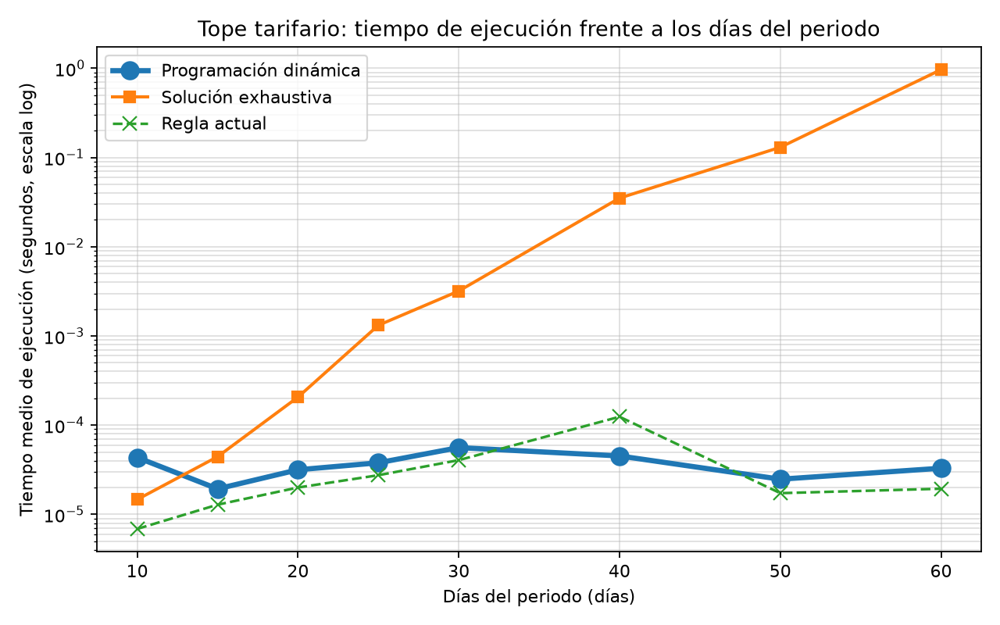

# Rediseño del proceso nocturno de recaudo del SITVM

**Integrantes:** 
- Isabella Bermudez Arboleda
- Sofia Villa Muñoz
- Carolina Uribe Builes
- Erian Jose Serna

**Caso asignado:** Caso 1 – Recaudo del transporte (Sistema Integrado de Transporte del Valle Metropolitano, SITVM)
**Operación desarrollada en esta entrega (Laboratorio 4):** operación 4, liquidación del tope tarifario (programación dinámica).

> Las demás operaciones del caso (deduplicación, ordenamiento y franjas de congestión) y el proceso completo se dejan como **Pendiente para la entrega del 23 de noviembre**.

---

## 1. Análisis del problema

### Operación 4: liquidación del tope tarifario

El objetivo es garantizar que ningún usuario con tarjeta personalizada pague, en el mes, más que la combinación más barata de pasajes y pases que cubra todos sus viajes. La diferencia se devuelve como saldo en la tarjeta. Hoy el sistema explora todas las combinaciones de pases, pero no termina para las tarjetas que viajan muchos días. A esas tarjetas se les aplica una regla simplificada que, en algunos meses, cobra más que el mínimo.

### Entradas

- Una lista de enteros con los viajes de la tarjeta en cada día calendario del mes (el cero indica un día sin viajes). El periodo varía entre 28 y 31 días.
- El monto que se le cobró realmente a la tarjeta durante el mes, en pesos (solo para calcular la devolución).
- Tarifas del perfil general:

| Producto | Valor | Cobertura |
|---|---|---|
| Pasaje sencillo | $3.900 | un viaje |
| Pase diario | $9.500 | un día calendario |
| Pase semanal | $36.000 | 7 días consecutivos |
| Pase mensual | $135.000 | 30 días consecutivos |

### Salida

- El costo mínimo, en pesos, de cubrir todos los viajes del periodo.
- La devolución al usuario: lo cobrado menos el costo mínimo, sin valores negativos.

### Restricciones

- Todos los viajes deben quedar cubiertos y el costo debe ser exactamente el de la combinación más barata: ni un peso de menos para el usuario ni un peso de más para el sistema.
- Un pase puede extenderse más allá del último día del periodo sin cobro adicional.
- Los días sin viajes no generan costo.
- Las tarifas corresponden al perfil del usuario (aquí, perfil general).
- El archivo original de validaciones no se modifica, para conservar la trazabilidad ante reclamaciones.
- Volumen real: cerca de 950.000 tarjetas por cierre de mes, en la ventana de 4 horas (00:00 a 04:00), en un servidor de unos 500 W.

### Supuestos

1. El pase diario cubre un día calendario, el semanal siete días consecutivos y el mensual treinta, contados desde el día en que empiezan.
2. Un pase siempre se compra el primer día aún no cubierto que tenga viajes. Los días sin viajes no generan cobro y no impiden que un pase vigente cubra días posteriores. Esta suposición se verificó con una fuerza bruta que prueba pases en cualquier día de inicio (ver sección 4).
3. La lista puede ser de un mes de 28, 29, 30 o 31 días. En un mes de 31 días, un pase mensual no cubre el último día, que se paga aparte (por ejemplo, 31 días con 3 viajes diarios cuestan $135.000 + $9.500 = $144.500).
4. Se admiten cero viajes por día; no se admiten cantidades negativas (la implementación lanza `ValueError`).
5. **Interpretación de la regla actual.** El caso dice que cada día se cobra lo más barato entre pasajes y pase diario, y que se cobra el pase semanal o mensual si la suma ya lo supera. Se interpretó así: desde el primer día con viajes, los días se agrupan en bloques fijos de 7 días, y si su cobro diario supera el pase semanal, se cobra este; igual con bloques fijos de 30 días y el pase mensual. La regla nunca reconsidera en qué día conviene empezar un pase.

---

## 2. Diseño de la solución

### Por qué programación dinámica

La decisión de comprar un pase semanal o mensual afecta el costo de varios días a la vez, así que elegir lo más barato para cada día por separado no siempre da el mínimo.

- **Subestructura óptima:** después de elegir un producto para cubrir los primeros días que quedan, el costo del resto del mes también debe ser el mínimo posible para esos días restantes.
- **Subproblemas traslapados:** distintas combinaciones de productos llegan a calcular el costo mínimo desde el mismo día. Por ejemplo, "pasaje el día 1 y pasaje el día 2" y "pase diario el día 1 y pasaje el día 2" terminan ambos preguntando por el día 3. Guardar el resultado de cada día evita repetirlo.

### Ejemplo resuelto a mano

Tarjeta con siete días de viajes:

| Día | 1 | 2 | 3 | 4 | 5 | 6 | 7 |
|---|---|---|---|---|---|---|---|
| Viajes | 3 | 3 | 3 | 0 | 2 | 0 | 3 |

Costo diario más barato: con 3 viajes, el pase diario ($9.500) es mejor que tres pasajes ($11.700); con 2 viajes, dos pasajes ($7.800) son mejores. Pagar día por día cuesta 4 × $9.500 + $7.800 = $45.800. El pase semanal cubre los siete días por $36.000.

Para confirmar que $36.000 es el mínimo se calcula `C(t)` de atrás hacia adelante:

| Día `t` | Viajes | Alternativas | `C(t)` |
|---|---|---|---|
| 8 | — | caso base | $0 |
| 7 | 3 | 9.500 + 0 · 36.000 + 0 | $9.500 |
| 6 | 0 | `C(7)` | $9.500 |
| 5 | 2 | 7.800 + 9.500 = 17.300 · 36.000 + 0 | $17.300 |
| 4 | 0 | `C(5)` | $17.300 |
| 3 | 3 | 9.500 + 17.300 = 26.800 · 36.000 + 0 | $26.800 |
| 2 | 3 | 9.500 + 26.800 = 36.300 · 36.000 + 0 | $36.000 |
| 1 | 3 | 9.500 + 36.000 = 45.500 · 36.000 + 0 | **$36.000** |

Hasta el día 3 conviene pagar solo ese día (26.800 contra 36.000). En el día 2 pagar día por día ya cuesta 36.300 y el pase semanal, 36.000, gana; en el día 1 también gana y cubre todo el periodo. El resultado (36.000) está verificado en `pruebas.py`.

### Recurrencia

Sea `d` el número de días del periodo (numerados de 1 a `d`) y `v(t)` los viajes del día `t`. `C(t)` es el costo mínimo de cubrir los viajes desde el día `t` hasta el día `d`.

- **Caso base:** `C(d+1) = 0` (no queda nada por cubrir).
- Si `v(t) = 0`: `C(t) = C(t+1)` (un día sin viajes no cuesta nada).
- Si `v(t) > 0`:

```
C(t) = min(  min(3900·v(t), 9500) + C(t+1),      # pasajes o pase diario, solo hoy
             36000 + C(min(t+7,  d+1)),           # pase semanal desde hoy
             135000 + C(min(t+30, d+1)) )         # pase mensual desde hoy
```

Cada término explica una decisión: la primera cubre solo el día `t` con lo más barato entre pasajes y pase diario; la segunda compra un pase semanal que cubre `t..t+6` y salta al primer día no cubierto; la tercera hace lo mismo con el pase mensual. `min(·, d+1)` impide pasarse del final del periodo (el pase "sobrante" no cobra de más).

**Orden de llenado:** la tabla se llena de atrás hacia adelante (`t = d, d-1, …, 1`), porque `C(t)` depende solo de días posteriores (`t+1`, `t+7`, `t+30`), que ya están calculados. La respuesta es `C(1)`.

La devolución se calcula como `max(0, cobrado − C(1))`.

---

## 3. Implementación

Código en [`src/tope_tarifario/`](src/tope_tarifario/):

| Módulo | Contenido |
|---|---|
| [`estrategia.py`](src/tope_tarifario/estrategia.py) | `costo_minimo` (programación dinámica con tabulación), `liquidar_tope`, `costo_minimo_contado` (con contador de celdas) |
| [`exhaustivo.py`](src/tope_tarifario/exhaustivo.py) | `costo_exhaustivo` (recursión sin memoria), `costo_exhaustivo_contado`, `costo_fuerza_bruta` (prueba todos los subconjuntos de pases, solo para 7 días o menos) |
| [`regla_actual.py`](src/tope_tarifario/regla_actual.py) | `costo_regla_actual` (regla simplificada del sistema) y su versión con contador |
| [`pruebas.py`](src/tope_tarifario/pruebas.py) | Pruebas con `assert` |

Decisiones de implementación relevantes:

- Todo está escrito a mano, sin bibliotecas de optimización. Las funciones llevan type hints y docstrings Google-style y cumplen PEP 8.
- La DP usa tabulación (un arreglo de `d+1` posiciones) y no recursión, para evitar el límite de recursión de Python en periodos largos.
- Las versiones `_contado` son copias de las funciones con un contador propio. Se mantienen aparte para que el contador no altere los tiempos medidos.
- Se agregó `costo_fuerza_bruta` porque `costo_exhaustivo` usa la misma recurrencia sin memoria: verifica el código pero no el modelo. La fuerza bruta no supone que un pase empiece en un día con viajes, así que valida el supuesto 2.
- Entradas con viajes negativos lanzan `ValueError`.

---

## 4. Evaluación del desempeño

### Complejidad

Sea `d` el número de días del periodo y `k` el número de días con viajes.

| | Tiempo | Espacio |
|---|---|---|
| Programación dinámica | Θ(d): una celda por día, con tres alternativas de costo constante | Θ(d): la tabla de `d+1` celdas |
| Solución exhaustiva | Exponencial en `k`: `T(t) = T(t+1) + T(t+7) + T(t+30) + Θ(1)`, que crece como λᵏ con λ ≈ 1,28 | Θ(d) por la profundidad de la recursión (cada llamada avanza al menos un día) |

La exhaustiva repite los mismos subproblemas (los mismos días de inicio se alcanzan por muchos caminos); la DP los calcula una sola vez.

### Cómo se verificó

`pruebas.py` (ejecutable con `python src/tope_tarifario/pruebas.py`) comprueba:

- **Casos límite:** lista vacía, un solo día, solo días sin viajes, un viaje, muchos viajes en un día, 7 días de pasajes sencillos, 7 días con pase semanal, 30 días con pase mensual y mes de 31 días.
- **Ejemplo a mano:** `[3,3,3,0,2,0,3]` da $36.000 con las tres soluciones.
- **Instancias aleatorias con semilla fija:** 75 comparaciones (25 contra la exhaustiva con 9 días, 25 contra la fuerza bruta con 7 días y 25 de hasta 40 días contra la exhaustiva) donde coinciden.
- **Restricción del negocio:** la devolución es exactamente `cobrado − mínimo` en 50 instancias de 31 días, nunca es negativa y `cobrado − devolución = mínimo`.
- **Regla actual:** nunca cobra menos que el mínimo (300 instancias) y falla en el contraejemplo de la sección 5.

### Medición

Datos en [`datos.py`](src/tope_tarifario/datos.py) y experimentos en [`medicion.py`](src/tope_tarifario/medicion.py).

- **Cómo se midió:** semilla fija (2026 + n), 3 instancias por tamaño, las mismas para las tres soluciones; 95 % de los días con viajes y hasta 4 viajes por día. Solo se cronometra la ejecución con `time.perf_counter()`. Se repite 200 veces cada DP y regla actual por instancia, y entre 1 y 5 veces la exhaustiva según su tamaño. En cada tamaño se verifica que la DP y la exhaustiva den el mismo valor.
- **Tamaños:** 10, 15, 20, 25, 30, 40, 50 y 60 días. Además, la DP y la regla actual se midieron solas hasta 122.880 días para sostener la extrapolación.




En la gráfica de operaciones la programación dinámica y la regla actual cuentan lo mismo (una operación por día, `d`), por eso sus líneas coinciden y la regla se dibuja encima de la DP con trazo punteado.

Operaciones elementales (celdas calculadas para la DP, llamadas recursivas para la exhaustiva, días revisados para la regla actual; promedio de 3 instancias):

| Días | DP | Exhaustiva | Regla actual |
|---|---|---|---|
| 10 | 10 | 48 | 10 |
| 15 | 15 | 141 | 15 |
| 20 | 20 | 497 | 20 |
| 25 | 25 | 1.406 | 25 |
| 30 | 30 | 4.491 | 30 |
| 40 | 40 | 39.747 | 40 |
| 50 | 50 | 342.928 | 50 |
| 60 | 60 | 3.928.323 | 60 |

### Lo medido contra lo esperado

Al duplicar el tamaño, cuánto se multiplicó cada medida (tabla impresa por `medicion.py`; los tiempos varían un poco en cada ejecución):

| Duplicación | DP: tiempo | DP: operaciones | Exhaustiva: tiempo | Exhaustiva: operaciones | Regla: tiempo |
|---|---|---|---|---|---|
| 10 → 20 | ×0,73 | ×2,00 | ×14,05 | ×10,42 | ×2,91 |
| 20 → 40 | ×1,43 | ×2,00 | ×169,94 | ×80,03 | ×6,21 |
| 30 → 60 | ×0,59 | ×2,00 | ×302,85 | ×874,71 | ×0,48 |

- **DP:** al duplicar `d`, las operaciones se duplican exactamente (×2,00), lo que coincide con Θ(d). El tiempo, en cambio, no se ve duplicar (×0,73, ×1,43 y ×0,59): entre 10 y 60 días la DP tarda entre 19 y 56 µs, y a esa escala el ruido de la máquina pesa más que el crecimiento (en la gráfica de tiempo la línea azul sube y baja sin una tendencia clara). La linealidad sí se ve en las mediciones a gran escala: de 30 a 122.880 días (×4.096) el tiempo pasó de 0,016 ms a 70 ms (≈ ×4.400), unos 0,5 µs por día en todos los tamaños.
- **Exhaustiva:** el factor no es constante, sino que crece con el tamaño (en operaciones ×10, ×80 y ×875). Eso es lo esperado de un crecimiento exponencial: al duplicar `d` el factor es aproximadamente λᵈ. Con λ ≈ 1,28 (la razón que se mide entre 50 y 60 días) se esperaría cerca de ×12, ×130 y ×1.500 para `d` = 10, 20 y 30. Los factores medidos quedan por debajo porque la razón por día entre tamaños consecutivos no siempre llega a 1,28 (entre 30 y 40 días es 1,24) y su promedio entre 10 y 60 días es de unos 1,25, que daría ×9,6, ×93 y ×890, cerca de lo medido. El tiempo crece igual de rápido en conjunto (de 10 a 60 días, ≈ ×65.700 frente a ≈ ×82.400 en operaciones), pero no factor a factor (×14, ×170 y ×303): el tiempo por llamada no fue constante (entre 0,25 y 0,94 µs) y a 50 y 60 días solo se cronometró una repetición por instancia. Desde 15 días la DP es más rápida que la exhaustiva y a 60 días lo es unas 29.000 veces; con 10 días ocurre lo contrario por el ruido de la medición.
- **Regla actual:** crece de forma lineal como la DP (×2,00 en operaciones); en tiempo sus factores son igual de ruidosos, con un pico a 40 días en la gráfica. Su costo es del mismo orden que el de la DP (a gran escala es entre 1,1 y 1,8 veces más rápida); lo que la diferencia de la DP es el resultado, no el costo de cómputo.

### Extrapolación al volumen real

Estimación con series de 31 días (80 % de días con viaje) y 950.000 tarjetas, ventana de 4 horas y potencia de 500 W (0,5 kW). Son **estimaciones** hechas en un solo equipo y salen de una sola ejecución de `medicion.py`; en otras ejecuciones el tiempo por tarjeta de la DP varió entre 11 y 19 µs, así que deben leerse como órdenes de magnitud.

Razonamiento: cada tarjeta se liquida de forma independiente de las demás, así que el tiempo total es lineal en el número de tarjetas: tiempo total = tiempo por tarjeta × 950.000. Esa regla de tres es válida solo por esa independencia, y se aplica al tiempo de una tarjeta de 31 días medido directamente (no extrapolado desde un tamaño menor).

| Solución | Por tarjeta | 950.000 tarjetas | ¿Cabe en 4 h? | kWh por cierre | kWh por año (12 cierres) |
|---|---|---|---|---|---|
| Programación dinámica | ≈ 18,8 µs | ≈ 17,9 s | Sí | 0,00249 | 0,0298 |
| Regla actual | ≈ 12,6 µs | ≈ 12,0 s | Sí | 0,00166 | 0,0199 |
| Exhaustiva (esta recursión) | ≈ 873 µs | ≈ 829 s (0,230 h) | Sí | 0,1152 | 1,382 |

Energía: kWh = kW × h, por ejemplo 0,5 kW × 0,0050 h ≈ 0,0025 kWh para la DP.

- **La exhaustiva con esta recursión sí cabe para 31 días**, pero su costo crece ×1,28 por cada día adicional con viajes (×1.503 por 30 días más): extrapolando desde los 0,97 s medidos a 60 días, a 90 días ya tardaría unas 0,40 h *por tarjeta* y a 120 días unas 606 h. Es decir, no termina en un horizonte largo.
- **El programa actual descrito por el cliente es mucho más grande:** prueba cualquier combinación de pases en cualquier día de inicio. Su número de combinaciones es 2^(2d) en la fuerza bruta incluida (≈ 2⁶² para 31 días), por lo que sencillamente no terminaría para tarjetas con muchos días de viaje, como dice el caso.
- **Diferencia a un año entre la regla actual y la DP:** la DP consume unos **0,0099 kWh más al año** que la regla actual (0,0298 frente a 0,0199 kWh). Es una diferencia despreciable; el argumento a favor de la DP no es el consumo, es que la regla actual cobra de más.

---

## 5. Análisis comparativo

### Contraejemplo de la regla actual

Tarjeta con 3 viajes el día 1, ningún viaje los días 2 a 4 y 3 viajes diarios los días 5 a 9:

`[3, 0, 0, 0, 3, 3, 3, 3, 3]`

- **Regla actual:** el bloque semanal de los días 1 a 7 acumula el día 1 y los días 5, 6 y 7: 4 × $9.500 = $38.000, que supera el pase semanal, así que se cobran $36.000. El bloque de los días 8 y 9 cobra 2 × $9.500 = $19.000. Total: **$55.000**.
- **Óptimo (DP):** pase diario el día 1 ($9.500) y pase semanal desde el día 5, que cubre los días 5 a 11 ($36.000). Total: **$45.500**.
- **Diferencia:** **$9.500** que la regla actual cobra de más y el sistema no devolvería.

La regla falla porque sus bloques semanales empiezan en el primer día con viajes y no se mueven; no considera que conviene empezar el pase el día 5, después de la pausa. Esta instancia está verificada en `pruebas.py`.

### Condición contraria

La estrategia voraz sería adecuada si solo existieran pasajes sencillos y pase diario: cada día se decidiría por separado entre dos productos de cobertura de un día y no afectaría a los días siguientes, así que bastaría con elegir lo más barato cada día. Con pases de varios días, una decisión de hoy afecta a los días siguientes, y por eso se requiere programación dinámica.

### Recomendación

Se recomienda adoptar la programación dinámica para liquidar el tope de cada tarjeta, en lugar de la exploración exhaustiva y de la regla simplificada.

- **Qué se gana:** devoluciones exactas (la regla actual cobra de más en el contraejemplo y con ella hay quejas), un tiempo de unos 18 s para las 950.000 tarjetas (frente a 4 h de ventana) y la posibilidad de liquidar todas las tarjetas en la noche del cierre y no semanas después.
- **Límites y riesgos:**
  - Si el volumen crece (por ejemplo, 30 % más validaciones), el tiempo crece de forma lineal: sería del orden de 23 s, muy por debajo de la ventana.
  - Si se crea un nuevo producto (por ejemplo, un pase de 15 días), basta agregar una alternativa a la recurrencia; el costo sigue siendo Θ(d).
  - Los tiempos medidos son de Python en un equipo de desarrollo; deben medirse de nuevo en el servidor real.
  - La interpretación de la regla actual (supuesto 5) debe confirmarse con la organización.

---

## 6. Implicaciones éticas, sociales y ambientales

### Consumo energético (operación 4)

A 500 W y con las estimaciones de la sección 4, la liquidación del cierre de mes consume unos 0,0025 kWh con la DP y unos 0,0017 kWh con la regla actual. A un año de operación (12 cierres): 0,0298 kWh frente a 0,0199 kWh, es decir, unos 0,0099 kWh más para la DP. Es una diferencia despreciable frente al beneficio de devolver exactamente lo que corresponde. Son estimaciones obtenidas de una medición en un solo equipo.

Pendiente para la entrega del 23 de noviembre: personas, normativa y crecimiento, y el consumo del proceso completo.

---

## 7. Conclusiones

Pendiente para la entrega del 23 de noviembre.

---

## 8. Reproducción

Abra una terminal dentro de la carpeta `RecaudoDelTransporte` y cree el entorno virtual:

**Windows**

```bash
python -m venv venv
venv\Scripts\activate
```

**Linux / macOS**

```bash
python3 -m venv venv
source venv/bin/activate
```

Con el entorno virtual activado, instale las dependencias del proyecto mediante el archivo `requirements.txt`:

```bash
pip install -r requirements.txt
```

Ejecute el archivo `pruebas.py` para validar el correcto funcionamiento de los métodos:

```bash
python src/tope_tarifario/pruebas.py
```

Ejecute el archivo `medicion.py` para las mediciones de tiempo y la generación de las gráficas en `graficas/tope_tarifario/`:

```bash
python src/tope_tarifario/medicion.py
```